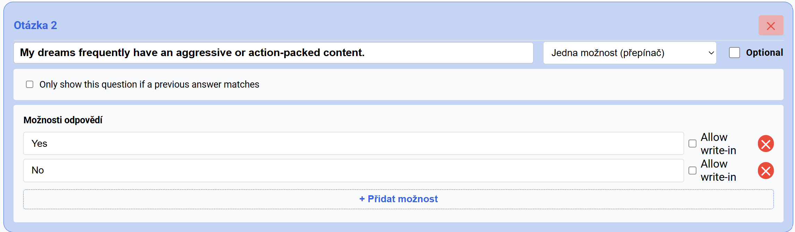
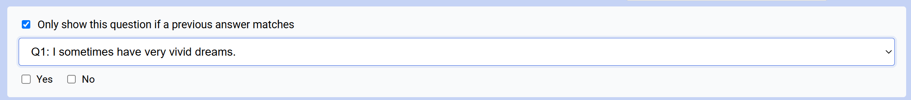
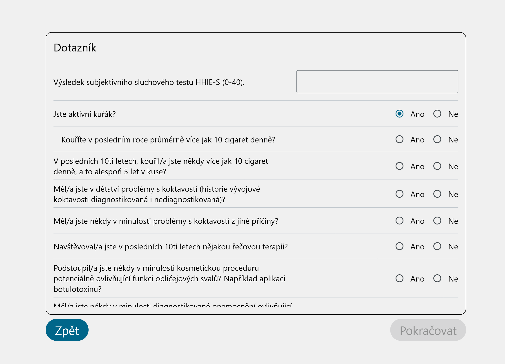
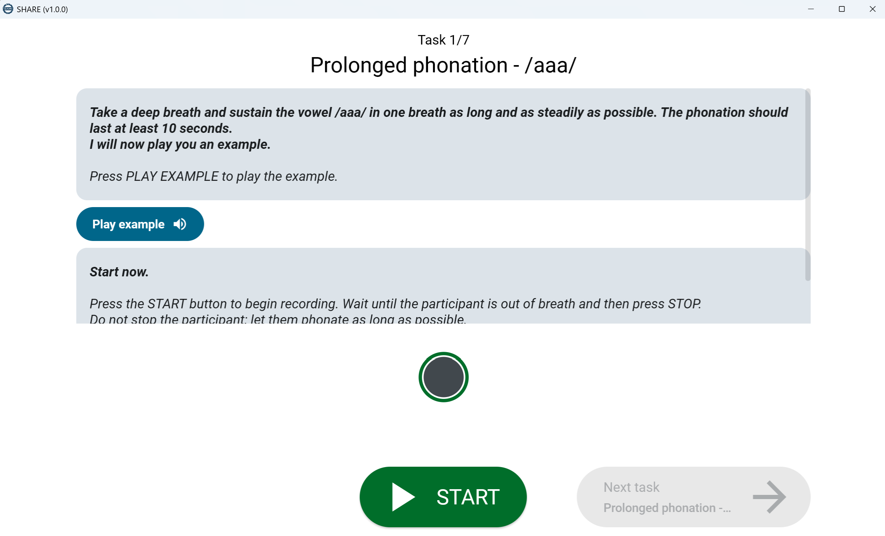
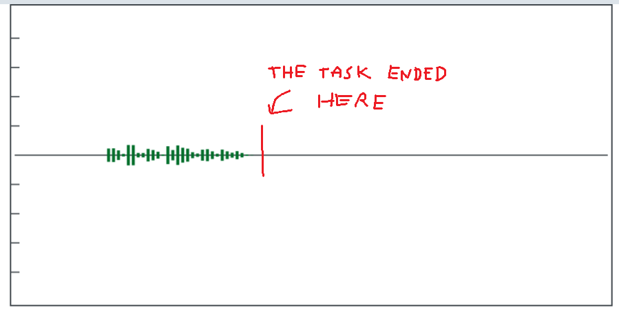
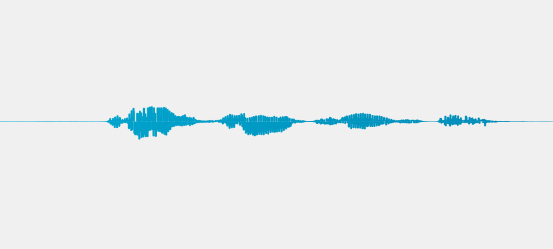
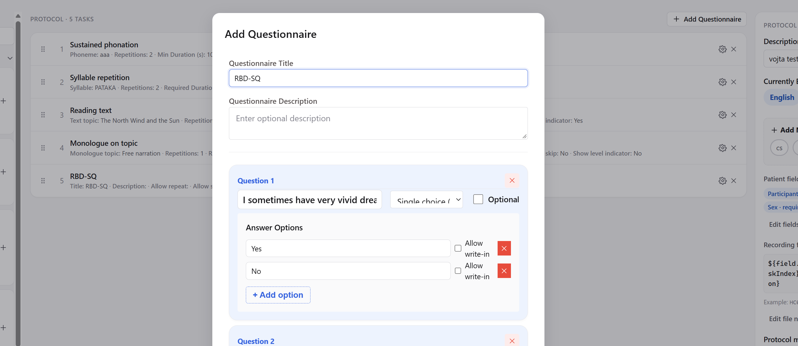

# Notes for the agent: app/web 30. 10. 2026

## App/web

- **Questionnaires:** Currently, the web configuration doesnt allow for applying conditional rules. Such rules can be that an appearance of given question depends on selected answer of another question. Implement the conditional functionality for both web and the app. Come up with an optimal solution how to apply conditional rule in the web configurator. Idea from the other web version - a tick box option in each question, when ticked it shows a dropdown with previous questions (single choices?) and their answers:

- In the app, the question would show only if the rule is fulfilled. The question might itself be mandatory - if shown, it would require user to fill it. If the rule is not fulfilled, the mandatory status of the hidden question is ignored.
- **Logs:** the app logs lot of possibly useful data for later debugging and diagnostic. Are they currently being sent? If not, they can be sent, associated with a given computer, and seen on the 'clinic' page (new folder 'Logs' for privileged users).

## App

- Questionnaires UI is very bare bone and maybe a bit confusing (especially the lack of horizontal dividers between the individual questions and unclear bottom boundary of the questions pane). Apply some basic formatting so the display of the questions is more clear and the questions are not accidentally skipped. Idea from a older shareapp version (horizontally divided, with boundary, conditional questions are indented (this could be done better), answers on the the same line are probably justifiable only when there is a few options):

- When the clinic has no inherited protocol, it shows a confusing blank Patient info page. Implement a single info line informing the user that no protocol is currently configured for this site.
- In the 'Sessions' page, the info informs about proces/reprocess button, which no longer exists. Drop this from the info.
- Progress/waveform indicator - when the screen is very small (which can happen) the indicator has a priority over the instructions (see the image below). This is better to be reversed (see the instructions all the time and the indicator only if there is space). Also, the current allocation of the space for waveform display takes a lot a vertical space below the circular indicator, which can be implemented more effectively (waveform is not visible at the beginning and during tasks):

- **Waveform preview:** maybe its just my device, but when the gain is small, the information from the waveform becomes very limiting. As discussed before, however, finer details would require additional buffer. Also, investigate the case, where there is apparently additional x-axis space appended to the task waveform:

- For comparison, this is the the waveform in the original shareapp (same audio as waveform above):

- Another discussion: is it necessary to have the full boundary around the waveform? Maybe just the 0 axis and y axis is optimal?

## Web

- Session detail contains a lot of information, which can be confusing for the clinicians. I would make the information which is useful only to the admins or developers foldable. So make 'Server checks' foldable, the section with 'Session ID', 'Zip SHA' and config version also foldable.
- Clicking on 'Copy' icon in the clinic token field does nothing.
- In the protocol editor, the width of the questionnaire configurator needs to be adjusted adaptively. It was too wide and now its too narrow:

- When a protocol is created/saved, it makes more sense from the UI perspective to exit the editor to the previous state/page.
- Pressing the main icon in the top left corner can brigs users to the frontpage (if they get lost in the subpages).
- Recordings table: Implement a functionality that the list is sortable by the columns (review status, study...). The custom sorts can be later reset by a dedicated button.
